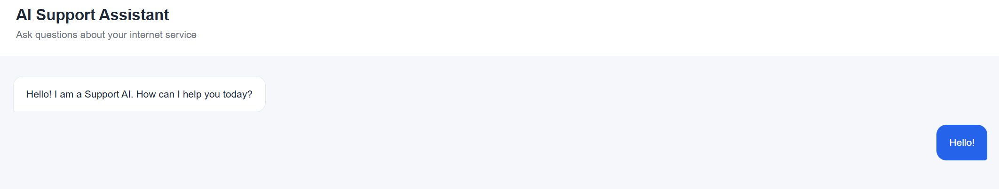
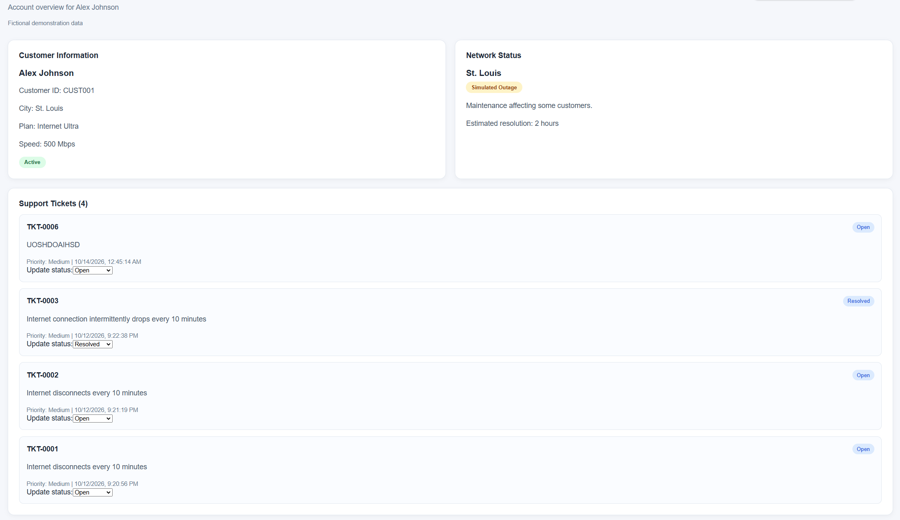
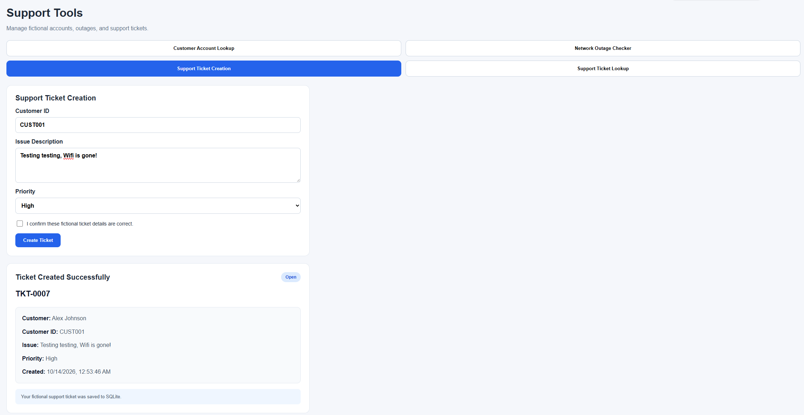

# Spectrum Support AI

A full-stack AI-powered customer support application built with **React, FastAPI, Google Gemini, Google ADK, and SQLite**.

The project demonstrates AI agent development, tool calling, REST API design, database persistence, and full-stack software engineering.

> **Disclaimer:** This is an independent portfolio project inspired by telecommunications customer support workflows. It is not affiliated with or endorsed by Spectrum or Charter Communications. All customer accounts, outages, and support tickets are fictional.

## Features

### AI Customer Support Agent
- Conversational AI powered by Google Gemini.
- Uses Google ADK to execute custom Python tools.
- Provides troubleshooting assistance for internet connectivity issues.
- Supports multi-step workflows involving customer information, network outages, and support tickets.

### Customer Account Lookup
- Retrieves fictional customer records using customer IDs.
- Displays account information, service plans, and account status.

### Network Outage Checker
- Checks simulated network outages by city.
- Provides descriptions and estimated resolution times.

### Support Ticket Management
- Creates support tickets following customer confirmation.
- Generates unique ticket identifiers.
- Stores support tickets persistently using SQLite.
- Retrieves existing tickets and updates their status to Open, In Progress, or Resolved.

### React Dashboard
- Interactive AI chat interface.
- Markdown-formatted AI responses.
- Customer account information.
- Simulated network status.
- Support ticket management with status dropdowns.
- Loading indicators and API error handling.

## Technology Stack

| Category | Technology |
|---|---|
| Frontend | React, JavaScript, Vite, CSS |
| Backend | Python, FastAPI |
| AI | Google Gemini, Google ADK |
| Database | SQLite |
| API Architecture | REST |

## System Architecture

```text
React Frontend
      |
      v
FastAPI Backend
      |
      +---- Google Gemini + ADK
      |            |
      |            v
      |       Python Agent Tools
      |
      +---- Customer & Outage Demo Data
      |
      +---- SQLite Database
                |
                v
          Support Tickets
```

The React frontend communicates with FastAPI. FastAPI handles both regular REST requests and AI-powered conversations.

Google ADK allows Gemini to call Python functions to retrieve customer information, check simulated outages, and manage support tickets.

SQLite stores support tickets persistently, allowing them to be retrieved and updated across application restarts.

## Screenshots

### AI Chat



### Customer Dashboard



### AI Support Ticket Creation



## Getting Started

### Prerequisites

- Python 3.12
- Node.js and npm
- Google Gemini API key

### 1. Clone the Repository

```bash
git clone https://github.com/KusumaWa/Agent-Project.git
cd YOUR_REPOSITORY
```

Replace the placeholder repository URL with your actual GitHub URL.

### 2. Set Up the Backend

```powershell
cd backend
python -m venv .venv
.\.venv\Scripts\Activate.ps1
python -m pip install -r requirements.txt
```

Copy `.env.example` to `.env` and add your Gemini API key:

```dotenv
GOOGLE_API_KEY=your_api_key_here
GOOGLE_GENAI_USE_VERTEXAI=FALSE
```

Start the backend:

```powershell
python -m uvicorn main:app --reload
```

FastAPI documentation: `http://127.0.0.1:8000/docs`

The SQLite database and required tables are initialized when the backend starts.

### 3. Set Up the Frontend

Open a second terminal:

```powershell
cd frontend
npm install
npm run dev
```

Open `http://localhost:5173` in your browser.

## Example AI Workflow

1. A customer reports an internet connectivity issue.
2. Gemini uses the customer lookup tool to retrieve fictional account information.
3. The agent checks simulated network outages in the customer's city.
4. The customer requests a support ticket.
5. The agent presents the proposed ticket details and asks for confirmation.
6. After confirmation, the agent creates a ticket in SQLite.
7. The customer dashboard displays the new support ticket.
8. A support representative can update the ticket's status.

## Example API Endpoints

| Method | Endpoint | Description |
|---|---|---|
| POST | `/chat` | Send a message to the AI agent |
| GET | `/customers/{customer_id}` | Retrieve customer information |
| GET | `/outages/{city}` | Retrieve simulated outage information |
| GET | `/customers/{customer_id}/tickets` | Retrieve customer tickets |
| PATCH | `/tickets/{ticket_id}/status` | Update a ticket's status |

## Current Limitations

This is a local demonstration application, not a production-ready customer support system.

- Uses fictional customer records and outage information.
- Uses a shared in-memory AI conversation session.
- Requires authentication and authorization before handling real customer data.
- Ticket creation confirmation is guided by agent instructions rather than enforced by backend authorization logic.
- Gemini API availability and usage are subject to Google's service limits.

## Future Improvements

- User authentication and role-based access control.
- Persistent, isolated conversation sessions.
- Automated unit and integration tests.
- Real-time dashboard refresh.
- Production deployment and monitoring.

## Project Purpose

Spectrum Support AI was developed as a portfolio project to demonstrate practical software engineering skills, including:

- Full-stack application development.
- AI agent orchestration and function calling.
- REST API development.
- SQL database design and persistence.
- Frontend state management.
- Error handling and debugging.
- Modular application architecture.